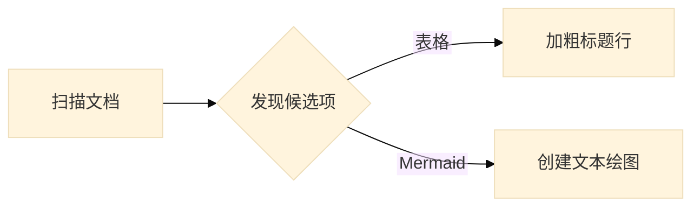
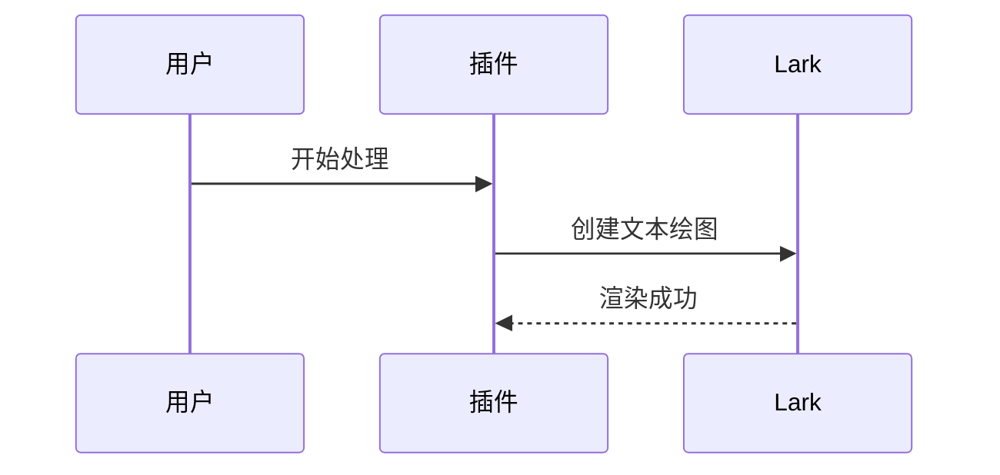

# Lark Markdown Repair 验收文档

## 普通表格

| 身份 | 生命周期 | 用途 |
| --- | --- | --- |
| 生成所有者 | 输入框或 Plan 卡片存在期间 | 隔离同时存在的生成入口 |
| generation_session_id | 一次正式提交前 | 串联 Picker 与最终提交 |

## Init Mermaid



## 关键字 Mermaid



## 无效 Mermaid

```mermaid
flowchart LR
    A[缺少结束括号 --> B
```

## 普通代码块

```typescript
const chartType = "flowchart";
console.log(chartType);
```
